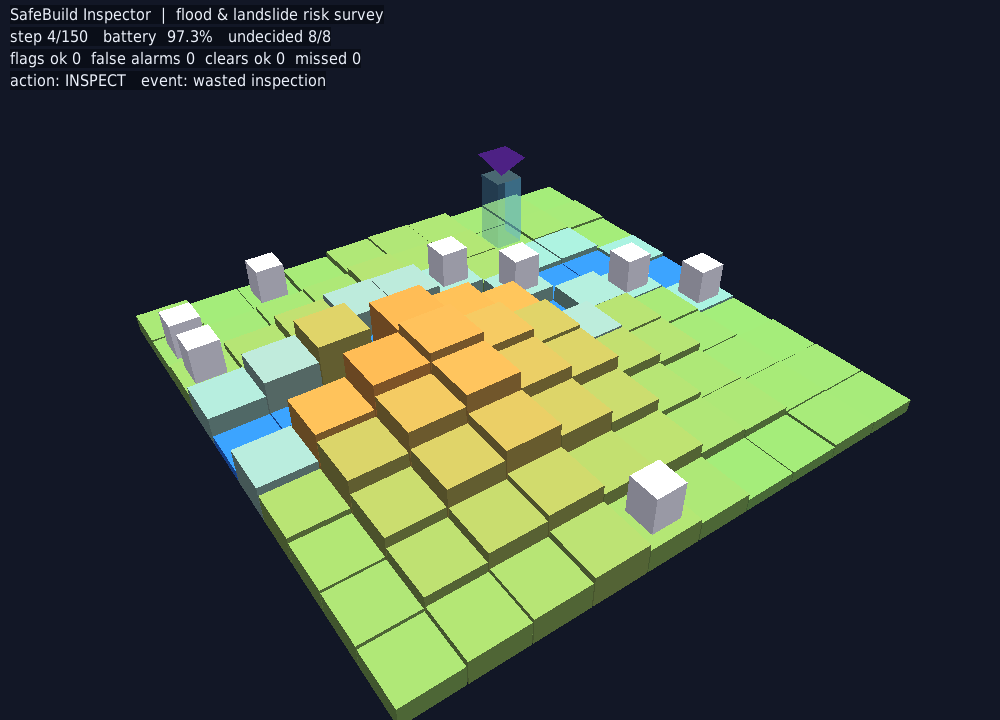

# SafeBuild Inspector — RL for detecting unsafe buildings in flood & landslide zones

An inspection drone surveys a district and must decide, building by building, whether each
structure is **safe** or must be **flagged** because it sits in a **river flood plain**, on a
**steep landslide-prone slope**, or has a **hidden building-code violation** (no approved plan,
setback breach) that is only revealed by an on-site **inspection**.

Four agents are trained on the *same* custom Gymnasium environment with **TorchRL**:

| Family | Algorithm | File |
|---|---|---|
| Value-based | DQN | `training/dqn_training.py` |
| Policy gradient | REINFORCE (with optional learned baseline) | `training/pg_training.py --algo reinforce` |
| Policy gradient | PPO (clipped) | `training/pg_training.py --algo ppo` |
| Policy gradient | A2C (actor-critic) | `training/pg_training.py --algo a2c` |



## Quick start (uv)

```bash
git clone https://github.com/DUSHIMEDanPaul/DUSHIME_Dan_Paul_rl_summative.git
cd DUSHIME_Dan_Paul_rl_summative
uv sync                 # creates .venv and installs everything from uv.lock
uv run main.py          # runs the best trained agent in the 3D window + verbose terminal log
```

Other options:

```bash
uv run main.py --algo ppo --episodes 3     # a specific algorithm
uv run main.py --renderer software         # 2.5D window if OpenGL is not available
uv run main.py --render none --record      # no window, saves assets/<algo>_agent.gif
uv run main.py --algo random               # untrained baseline
uv run pytest                              # environment tests
```

## Environment

| Element | Definition |
|---|---|
| **Map** | 10×10 district, procedurally generated per episode: elevation with a hill, a river (random walk N→S), flood plain (low cells within 2 cells of the river), slope from the elevation gradient, 8 buildings (about half in hazard zones) |
| **Agent** | Inspection drone with a battery of 150 actions |
| **Action space** `Discrete(7)` | 0 MOVE_NORTH, 1 MOVE_SOUTH, 2 MOVE_EAST, 3 MOVE_WEST, 4 INSPECT, 5 FLAG_UNSAFE, 6 CLEAR_SAFE |
| **Observation** `Box(87,)` in [-1, 1] | position (2), battery (1), share of undecided buildings (1); current cell: undecided building, flood risk, slope, inspected, violation revealed (5); direction and distance to nearest undecided building (3); 5×5 local maps of undecided buildings, flood risk/river and slope (75). Off-map cells = -1 |
| **Ground truth** | building is UNSAFE if flood risk > 0.5 **or** slope > 0.6 **or** hidden violation (30% chance, visible only after INSPECT) |
| **Start state** | drone at the depot (0,0), full battery, all buildings undecided, new random map |
| **Terminal** | all buildings decided (terminated) or battery empty after 150 steps (truncated) |

### Reward structure

| Event | Reward |
|---|---|
| every step (battery/time) | −0.05 |
| flying off the map | −0.5 |
| first inspection of an undecided building | +0.5 |
| wasted inspection | −0.2 |
| correctly flag an unsafe building | **+10** |
| wrongly flag a safe building (false alarm) | −6 |
| correctly clear a safe building | +5 |
| clear an unsafe building (missed hazard) | **−10** |
| flag/clear where there is no undecided building | −0.2 |
| mission complete (all decided) | +15 |
| approach shaping: Φ(s′) − Φ(s), Φ = −0.2 × distance to nearest undecided building | ±0.2 per cell |

Missing a hazard is the most expensive error because, in the real world, it leaves people living
in a dangerous house. The shaping term is potential-based (Ng, Harada & Russell, 1999): it guides the drone towards
buildings without changing the optimal policy. A random policy scores about −64 per episode; a
perfect inspector about +80.

### Visualisation

* `environment/rendering.py` → **OpenGLRenderer**: real-time 3D (PyOpenGL + pygame) with extruded
  terrain, 3D buildings coloured by status, a hovering drone with a scan beam and a slowly orbiting camera.
* **SoftwareRenderer**: 2.5D isometric renderer (Pillow) that needs no display, used for notebooks and GIFs.

Colours: white = undecided, yellow = inspected, red = flagged unsafe, green = cleared safe,
blue = river, blue tint = flood plain, orange tint = steep slope.

## Training (10 hyperparameter configurations per algorithm)

```bash
uv run python -m training.dqn_training --sweep                 # DQN configs 0-9
uv run python -m training.pg_training --algo reinforce --sweep
uv run python -m training.pg_training --algo ppo --sweep
uv run python -m training.pg_training --algo a2c --sweep
uv run python -m training.analyze                              # figures + tables in assets/
```

Use `--config N` for a single run and `--frames N` to change the budget. The configurations are in
`training/configs.py`. Every run writes `logs/<algo>/cfgN_seed0/` (episode returns, losses, entropy,
config) and appends to `logs/<algo>_sweep_results.csv`. Each trained model is evaluated on **20 unseen maps** (generalisation test) in two modes: greedy
(argmax) and stochastic (sampling the policy for PG methods, ε = 0.05 for DQN) and the best one per algorithm is saved as
`models/dqn/best_dqn.pt` or `models/pg/best_<algo>.pt`, which `main.py` loads.

You can also train in a notebook: `notebooks/train_notebook.ipynb` (Colab or Jupyter).

## Project structure

```
├── pyproject.toml, uv.lock, README.md, main.py
├── environment/  custom_env.py (Gymnasium env), rendering.py (OpenGL + 2.5D)
├── training/     dqn_training.py, pg_training.py, configs.py, common.py, analyze.py
├── models/       dqn/, pg/  (saved weights)
├── logs/         training logs and sweep results
├── assets/       screenshots, figures, GIFs
├── notebooks/    train_notebook.ipynb
└── tests/        test_env.py
```
